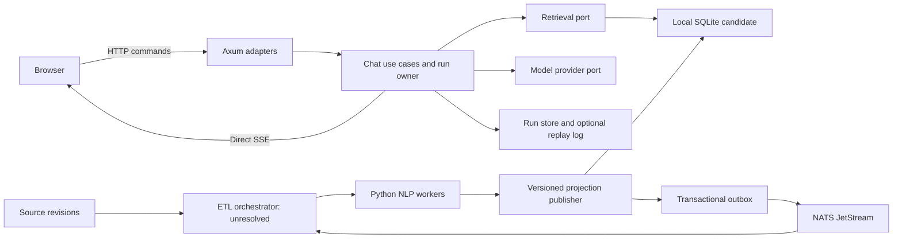

# Backend architecture draft

Status: proposed design, 2026-11-05. This document specifies boundaries and failure contracts; it does not describe implemented services or measured performance.

## Serving and enrichment boundaries

Rust with Axum/Tokio owns authenticated chat, retrieval orchestration, run lifecycle, and streamed responses. Python workers perform document parsing and NLP enrichment through a versioned ETL DAG. NATS JetStream carries durable background events. SQLite is a retrieval candidate, subject to workload evaluation. This split aims to isolate live requests from ingestion interference; it does not establish that Rust has the lowest end-to-end latency.

Axum provides SSE response primitives, including event streams and keepalives. The browser reaches this endpoint directly through a streaming-capable ingress; no frontend application server or broker is required to relay ordinary token deltas. [Axum SSE](https://docs.rs/axum/latest/axum/response/sse/index.html)

## Domain and application contracts

Domain types distinguish tenant, conversation, run, generation attempt, source revision, chunk, and evidence identifiers. Constructors validate identifiers and bounded inputs. An evidence reference names immutable source bytes, a revision, and a source location. Extracted graph claims additionally preserve polarity, temporal qualifiers, and extraction provenance.

Use cases include starting a run, retrieving evidence, streaming events, canceling a run, and publishing an enrichment revision. Their ports cover authorization, retrieval, model generation, run persistence, artifact storage, and event publication. Axum, SQLite, provider HTTP clients, and NATS implement adapters. Keep domain rules independent of transport DTOs and database rows; introduce traits at real substitution or testing boundaries rather than wrapping every function.

Expected outcomes use explicit errors: invalid input, unauthorized access, conflict, overload, unavailable dependency, deadline, and cancellation. Provider failures remain distinguishable from empty retrieval. HTTP mappings and sanitized diagnostic fields belong in adapters.

## Runs, streaming, and ownership

A start command accepts an idempotency key and returns a run identifier. A run has one authoritative owner and an increasing attempt epoch. Before multiple serving replicas are enabled, the run-store adapter must support atomic ownership acquisition, lease renewal, and fencing checks on every authoritative write. A lease alone cannot prevent an expired owner from publishing stale results.

Run states are accepted, retrieving, generating, and one terminal outcome: completed, canceled, failed, or interrupted. Events carry run ID, attempt epoch, sequence number, type, and payload. Sources, status changes, text deltas, and terminal outcomes are separate event types. Stop is an authenticated HTTP command; the browser closing an SSE connection is a transport event. The disconnect continuation/grace policy remains an explicit product decision.

Direct streaming is the default. Cross-device continuation, multiple viewers, and reconnect replay require an optional retained per-run output log with a specified retention and durability policy. Resume reads after a sequence and deduplicates overlap with live delivery. Replaying stored output cannot resume a lost model inference state. A failed generation worker produces an interrupted attempt or an explicitly new continuation attempt, never silent regeneration presented as the same stream.

## Deadlines and resource ownership

Propagate one request budget into stage deadlines for retrieval, reranking, provider connection, first output, and idle streaming. Independent retrieval operations may overlap. Avoid mandatory serial model-based query rewriting for ordinary requests.

Each run owns its child-task handles and cancellation token. Cancellation stops local work, closes provider streams, and invokes a provider cancellation facility when supported; remote computation or billing may continue. Dropping a future does not automatically stop independently spawned tasks. Shutdown stops admission, signals cancellation, then joins tracked tasks within an operational deadline. [Tokio cancellation](https://tokio.rs/tokio/tutorial/select), [shutdown](https://tokio.rs/tokio/topics/shutdown)

Set bounded admission queues, concurrent-run permits, provider permits, event-buffer bytes, payload sizes, and graph-expansion limits. Slow subscribers receive a resumable disconnect when retention permits, or a defined failure. They cannot accumulate unlimited output. Separate ingestion and chat capacity. Numeric limits and latency objectives require representative load tests.

## Retrieval and publication

SQLite can colocate canonical chunks, FTS5 BM25, vector indexes, and typed adjacency tables. Fuse independently ranked lexical/vector candidates; evaluate bounded graph expansion against the same baseline. FTS5 relevance sorts ascending, so lower BM25 values are better. [FTS5](https://www.sqlite.org/fts5.html)

Vector selection remains open: stable sqlite-vec exact search, its prerelease DiskANN path, and SQLite's distinct Vec1 ANN extension require recall, filtering, update, and latency comparisons. Do not assume arbitrary SQL filters execute inside a vector index. [sqlite-vec releases](https://github.com/asg017/sqlite-vec/releases), [Vec1](https://www.sqlite.org/vec1.html)

The initial SQLite topology is a local retrieval owner with serialized writes and a bounded pool of database threads/read connections. WAL permits concurrent readers and a writer, but only one writer at a time, and requires same-host access. Long reads can delay checkpoints. Do not mount one writable WAL database across hosts. End retrieval transactions before waiting on model output; carry immutable evidence/version references forward. [SQLite WAL](https://www.sqlite.org/wal.html)

Synchronous queries run outside Tokio execution workers. Bound both queued work and active operations; a timeout around a future cannot abort an already-running blocking task. Use supported database interruption/progress mechanisms where appropriate and prevent a late cancellation from interrupting the next borrower of a connection. [Tokio blocking work](https://docs.rs/tokio/latest/tokio/task/fn.spawn_blocking.html)

## ETL durability and decision gates

The DAG publishes separate text, vector, and graph readiness milestones. Its artifacts record source revision, input hashes, parser/chunker versions, model/prompt/schema versions, and dependency identities. Publication checks that the source revision remains current; deletes retract obsolete evidence. Authorization applies to every retrieval branch and evidence fetch.

Dagster versus Temporal remains unresolved. No custom durable scheduler is promised. The selected orchestrator owns dependencies and workflow recovery; JetStream owns event transport. Consumers tolerate redelivery, commit idempotently, and acknowledge afterward. A transactional outbox closes the database-commit/event-publication gap; it does not create exactly-once external model execution. [JetStream acknowledgments](https://docs.nats.io/learn/jetstream/delivery-and-acknowledgment)

Before implementation, settle ownership storage, disconnect/replay guarantees, orchestration, vector extension, and deployment durability. Validate first-useful-token latency, token gaps, cancellation, saturation, filtered recall, ingestion freshness, checkpoint behavior, and crash recovery together.
