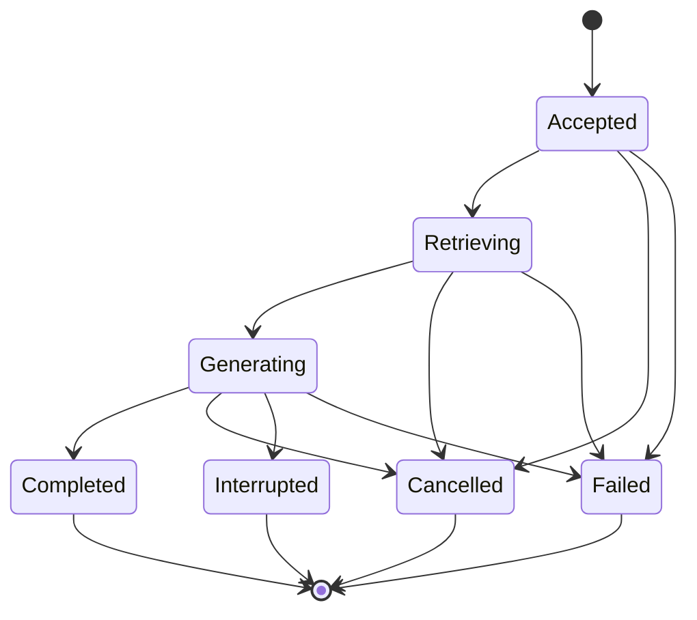

# Contracts and event lifecycle

<span class="status-label">DRAFT · ILLUSTRATIVE CONTRACTS</span>

These contracts describe required behavior for future implementation. They are not live endpoints. Transport DTOs map to domain commands; domain policies do not depend on HTTP, a broker, or a model provider's event format.

## Browser commands

| Proposed endpoint | Behavior |
| --- | --- |
| `POST /v1/conversations/{id}/runs` | Authorize, deduplicate an idempotency key, persist an accepted run, return run identity and cursor |
| `GET /v1/runs/{id}/events?after={cursor}` | Authorize subscription, replay retained events when available, then deliver live events |
| `POST /v1/runs/{id}/cancel` | Idempotently record cancellation intent and notify the current run owner |
| `GET /v1/conversations/{id}` | Return a bounded authorized snapshot with per-run checkpoints |

Choose cookie or token authentication before implementation. Native EventSource and fetch-based SSE have different header and reconnection behavior. The browser client must implement the behavior of its chosen transport explicitly. Browser subscriptions terminate at the authorized gateway, not at internal broker subjects.

## Event envelope

```json
{
  "schema_version": 1,
  "event_id": "evt_example",
  "conversation_id": "conv_example",
  "run_id": "run_example",
  "attempt": 1,
  "sequence": 42,
  "type": "answer.delta",
  "payload": { "text": "A supported answer fragment" }
}
```

A cursor identifies a position in one retained run attempt's history. Its encoding remains open. A conversation snapshot includes a checkpoint `{run_id, attempt, cursor}` for each resumable run; a cursor must never be reused for a different run or attempt. A start command supplies the checkpoint for the newly accepted run. Deliver deltas, source records, retrieval status, terminal state, and errors as distinct typed events. Source records include document revision, source anchors, and evidence IDs.

## Run authority



Cancellation intent is separate from transport disconnect. The run owner serializes competing terminal transitions. Attempts carry fencing information so a stale owner cannot append or complete a newer attempt. The exact lease and fencing mechanism is open until durable storage and deployment topology are selected.

## Ordering and recovery invariants

1. Accepted commands are durable before success is acknowledged.
2. Each append is authorized for the current run attempt and ordered by sequence.
3. Clients deduplicate replay overlap, detect gaps, and reject stale attempts.
4. Each run snapshot and its live subscription share a run-scoped checkpoint boundary. Catch-up handles the interval between them.
5. Retention expiry returns an explicit resynchronization result and a new snapshot.
6. Terminal status is authoritative. A completed record cannot be silently changed by a late delta.
7. No reconnect silently starts a second model generation.

Replay of persisted deltas restores output. It does not reconstruct a provider's hidden inference state. A worker failure produces interruption or a defined continuation attempt.

## Durability policy to decide

Direct delivery with asynchronous batched persistence minimizes synchronous storage work, but recently displayed text may be absent after a crash. Persist-and-ack before delivery provides a stronger displayed-output guarantee at additional cost. Measure both before choosing. Record transcript durability separately from short-lived status events.

## Evidence and publication contracts

Retrieval returns eligible, versioned evidence with original text, source anchors, retrieval provenance, and claim qualifiers. The adapter reports approximation, filtering, cancellation, and snapshot capabilities. Generated enrichment remains labeled and linked to its dependencies.

Publication checks the current source revision and artifact fingerprint in the same authority that activates an index version. The transaction also records a boundary event for outbox publication. Consumers reconcile versioned state rather than relying on receiving every notification.
