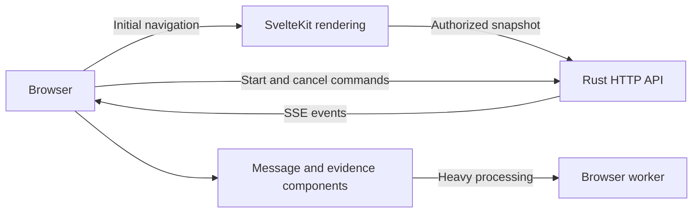

# Frontend architecture

**Status: draft architecture.** The proposed application frontend uses **Svelte 5, SvelteKit, and TypeScript**. This repository contains design documentation; it does not yet implement the chat application. VitePress powers this documentation site and is separate from the proposed SvelteKit product.

The frontend must keep typing, reading, source inspection, and cancellation responsive while an answer streams. Framework selection supports that goal; comparative browser measurements must establish the result.

## Rendering and network boundaries

SvelteKit renders the initial application shell and authorized conversation snapshot when server rendering improves startup. Public, identical pages may be prerendered. Interactive chat then connects to Rust over HTTP commands and SSE. An edge proxy can provide one public origin while routing API traffic directly to Rust, without passing answer chunks through the SvelteKit rendering server.

SvelteKit supports page-level rendering choices and hydration. Its state-management guidance also requires care with long-lived server processes: conversation state must remain request-scoped during SSR. [Page options](https://svelte.dev/docs/kit/page-options), [Server state guidance](https://svelte.dev/docs/kit/state-management)

The browser receives application events, not internal NATS subjects or database rows. A versioned wire schema defines identifiers, event payloads, source references, and errors. Runtime validation complements TypeScript types at this boundary.

## State and component ownership

Normalize state by conversation, run, message, and source identifiers. Each active run tracks its attempt, last applied sequence, status, text segments, and source references. The composer owns its draft locally. The active answer, source panel, and ingestion-status panel subscribe to their own state.

Svelte's reactive object properties support granular updates. That mechanism is a fit for independent panels; it does not prove an end-to-end speed advantage over another framework. [Svelte state](https://svelte.dev/docs/svelte/$state)

| Component | Owns | Avoids |
| --- | --- | --- |
| Conversation view | Message order and history window | Reconstructing all message content for each delta |
| Active answer | Current run's incremental text | Owning unrelated source or ingestion state |
| Evidence panel | Structured citations and source locations | Treating generated prose as the source of citation identity |
| Composer | Draft, submission state, keyboard interaction | Waiting for Markdown or graph computation |
| Graph explorer | Visible graph subset and selection | Running layout while hidden |

## Stream lifecycle

The proposed interaction creates a run through an HTTP command, then subscribes to its event stream. Cancellation is a separate authenticated, idempotent command. A browser disconnect follows an explicit server policy; it does not implicitly establish cancellation.

Initial rendered state includes a snapshot cursor. After hydration, the client requests events after that cursor, deduplicates overlap, and verifies run/attempt identifiers before applying deltas. Missing sequences trigger replay when retained history exists. If replay is unavailable, the server returns an explicit resynchronization response and the client loads a current snapshot. Reconnect support is a server/client protocol feature, not an automatic consequence of using SSE.

Proposed event categories are run status, retrieval progress, sources, text delta, terminal completion, cancellation, and error. A terminal event closes that attempt's transition path; late events from an older attempt cannot append to a replacement answer.

## Rendering work and reading behavior

Display the first meaningful text promptly, then coalesce visual updates around display frames. Use a streaming-aware Markdown renderer with stable blocks and a provisional trailing region. Reference links and other constructs can affect earlier output, so the renderer must preserve those dependencies rather than assuming every completed paragraph is immutable.

Load document viewers, graph exploration, math rendering, and syntax grammars independently. Move expensive parsing or graph layout to a browser worker when profiling justifies it; DOM changes remain on the main thread. Keep executable document content outside the application origin and render source/model text through restricted rendering paths.

Preserve text selection and scroll anchors. Follow new output while the reader is at the end; retain their position when they scroll back. Long histories may use windowing with measured message heights and an accessible history-loading mechanism. Keyboard navigation, visible focus, source labels, and reduced-motion preferences are acceptance criteria. Screen readers receive useful status updates rather than announcements for every token.

## Acceptance evidence and open decisions

The browser benchmark must combine long history, streamed Markdown with incomplete fences and tables, late citations, typing, cancellation, and an open graph panel. Measure startup, first visible answer text, input delay, long tasks, frame stability, memory, and reconnect correctness on a slower device. No numeric performance result is claimed yet.

Before implementation, resolve the snapshot/replay contract, retention policy, document-viewer isolation, Markdown renderer, history-windowing behavior, and which routes benefit from SSR. The first vertical slice should prove one cited answer, interruption, and reconnect before adding graph exploration.
