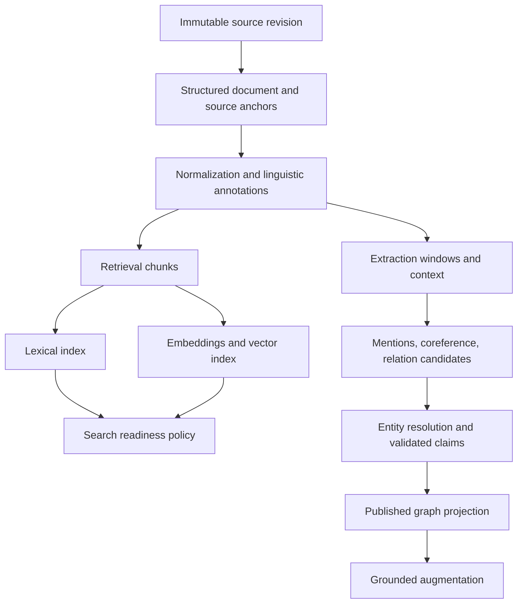

# Ingestion and enrichment DAG

DRAFT · EXECUTION ENGINE OPEN

Represent ingestion as a durable dependency graph over versioned artifacts. The DAG determines what can run; the orchestrator owns execution state and retries. Document processing runs independently of chat, with its own CPU, GPU, model quotas, and database publication capacity.

## Artifact dependencies

Nodes are outputs with explicit dependencies, not a requirement to schedule every noun as a remote job. Execute document operations or useful batches. Dependent metadata and source context are part of the input fingerprint.

## Parsing and chunking

Preserve the original file and a structured representation of headings, paragraphs, tables, captions, lists, and code. OCR and normalization retain mappings to source locations and document revisions. Retrieval chunks link to larger parent sections. Extraction windows include the context needed for pronouns, aliases, and relationships spanning boundaries.

Docling is a candidate for structure-aware and token-aware chunking. Parser accuracy and source-anchor fidelity require tests on the actual formats. [Docling chunking](https://docling-project.github.io/docling/concepts/chunking/)

## NLP and entity extraction

Choose linguistic processing by task and language: sentence boundaries, abbreviations, named entities, relevant domain concepts, coreference, and relationship candidates. Keep annotations separate from original text. General NER labels alone may omit concepts important to a technical corpus.

Entity linking is a separate decision from mention detection. Candidate generation can use identifiers, aliases, types, dates, surrounding entities, and semantic context. Resolve when supported; preserve unresolved local identities otherwise. Record merge and split decisions so corrections can be reversed. spaCy documents context-based linking to canonical IDs as a distinct component. [spaCy entity linking](https://spacy.io/api/entitylinker)

## Claims and augmentation

Store claims with evidence spans, negation, modality, time, document revision, and extraction provenance. For example, a possible future acquisition remains a possibility attributed to a source. It is not automatically an established ownership relationship.

Build grounded entity descriptions, section context, aliases, table descriptions, or summaries as separate derived artifacts. Synthetic questions are optional and must improve measured retrieval. An augmentation does not become an independent source or a second corroborating citation. Microsoft GraphRAG provides a reference separation of graph extraction, augmentation, summaries, and embeddings. [GraphRAG indexing](https://microsoft.github.io/graphrag/index/default_dataflow/)

## Durable execution contract

An artifact fingerprint includes input hashes, source revision, relevant entity-resolution snapshot, stage implementation, schema, model, prompt, and configuration versions. A successfully committed output can be reused only when those dependencies match.

The orchestrator owns attempts, leases, timeouts, bounded retries, and readiness. Outputs commit idempotently before task acknowledgment. External model calls can have ambiguous completion after failure; persisted output reuse reduces duplication without promising exactly-once inference. Check current revision and attempt authority before publishing.

NATS can deliver source-change and committed-readiness events. If Dagster or Temporal owns internal activities, use that engine's scheduling semantics. Do not create a competing retry loop in broker consumers. Store an outbox entry with the committed output, then publish boundary events with deduplication and reconciliation.

## Readiness and corrections

Track lexical, vector, graph, and augmentation readiness separately, per revision. `search_ready` is a defined policy over the capabilities required by a given search route. Optional enrichment failures do not remove already usable source text.

When a revision changes, invalidate affected descendants. An entity-resolution correction rebuilds affected claims and derived profiles; embeddings change only if they depend on those modified artifacts. A deleted revision retracts its supporting evidence. Late work cannot promote an obsolete revision.

The knowledge graph may contain cycles. Refinement uses a bounded extraction/validation/repair sequence or an explicitly bounded task, with new output versions. It must have a stopping rule.

## Orchestrator decision

Evaluate Dagster's asset/dependency model for ETL lineage and backfills and Temporal's durable workflows for long-lived per-document execution. Select one progression owner. Workflow state storage is an operational decision separate from SQLite retrieval storage. [Dagster ETL](https://dagster.io/docs/guides/build/assets/modeling-etl-pipelines), [Temporal workflows](https://docs.temporal.io/workflow-execution)
