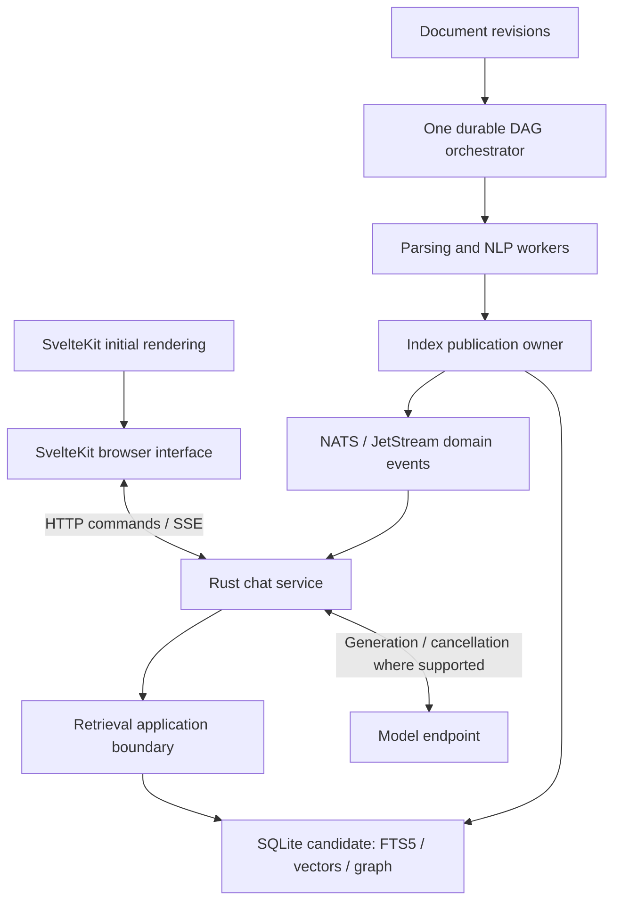

# System architecture

DRAFT · DESIGN BASELINE

Deliver fast, grounded answers from a versioned document corpus. Keep document enrichment outside the live answer path and publish useful retrieval capabilities as they become ready. Performance is an end-to-end property: model processing, retrieval, queueing, network placement, and browser work all contribute.

## System boundaries

These are responsibility boundaries, not a requirement to deploy every box separately. Start with the fewest processes that preserve resource isolation and failure ownership. Database locality and model placement must be tested before adding service hops.

## Conversation path

The browser submits an idempotent message command. Rust authorizes access, creates a run, retrieves eligible evidence, builds bounded context, and streams model output as structured events. One authoritative run owner decides ordering, cancellation, completion, and failure. UI event order is scoped by run and attempt.

SvelteKit may render the initial page and a bounded history snapshot. Active tokens travel directly from Rust to the browser. No frontend server proxy is required in that path. The snapshot includes a checkpoint per resumable run so the client can catch up without a replay/live subscription gap; cursors are scoped to that run and attempt.

Direct SSE is the default. A retained run-output log and separate generation workers are justified if independent generation, multiple viewers, or cross-device catch-up become required. Replaying recorded text does not resume a failed inference process.

## Knowledge path

BM25 and vector retrieval produce candidates over eligible document revisions. Combine ranks, expand selected graph relationships within explicit bounds, optionally rerank, and fetch original evidence. Every result carries document version and source anchors. Entity linking and graph traversal complement lexical and semantic search.

SQLite is a candidate for local retrieval, not an approved distributed database. [Retrieval storage](/architecture/retrieval) describes extension capabilities, single-writer constraints, filtering correctness, and replacement seams.

## Ingestion path

A source revision creates a durable workflow. Parsing preserves structure and source locations. Retrieval chunks and larger extraction windows support different tasks. Embeddings and lexical indexing can progress independently of entity resolution, claim validation, and augmentation.

The orchestrator owns dependencies, retries, and readiness. NATS carries appropriate boundary events; it does not become a second scheduler. If the chosen orchestrator provides task queues, use its own execution protocol for those activities.

## Principles carried into this draft

1. Core evidence and run policies do not import Axum, SQLite, NATS, or an orchestration SDK.
2. Adapter contracts expose filtering, approximate-search, cancellation, and snapshot limitations.
3. One owner governs each state machine and one publication rule selects current artifacts.
4. Buffers, retrieval fanout, graph expansion, background compute, and retry budgets are bounded.
5. Source claims, resolution decisions, and generated augmentations remain distinguishable.

These constraints respond to the [three design reviews](/reviews/). They are requirements for implementation and future tests, rather than evidence that an implementation already satisfies them.
