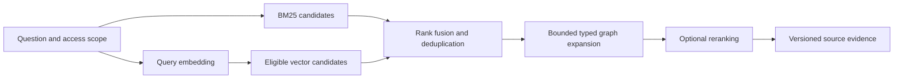

# Hybrid retrieval and evidence

DRAFT · SQLITE UNDER EVALUATION

Evaluate SQLite as a unified local retrieval tier: canonical document data, FTS5 BM25, a vector extension, and bounded graph expansion. Its potential advantage is shared local data with fewer network round trips. It must earn selection against the same relevance, filtering, ingestion, and latency workload as a dedicated retrieval service.

## Three complementary signals

| Signal | Proposed role | Implementation candidate |
| --- | --- | --- |
| Lexical | Names, identifiers, exact terminology | FTS5 BM25 |
| Semantic | Related meaning and paraphrases | Versioned vector extension |
| Relationships | Definitions, dependencies, related evidence | Typed graph tables with forward/reverse indexes |

FTS5 supplies BM25 ranking; numerically lower scores are better matches. Its tokenizer and document granularity need corpus-specific evaluation. [FTS5 documentation](https://sqlite.org/fts5.html)

## Vector capability decision

Compare exact and approximate search using an exact reference set. SQLite's own Vec1 extension offers ANN and exhaustive modes. Its ANN mode uses trained index structures, supports qualifying metadata predicates, and has query-shape considerations for filtered joins. It is a separately compiled/loaded extension, not an assumed feature of every SQLite binary. [Vec1 overview](https://www.sqlite.org/vec1.html), [Vec1 manual](https://www.sqlite.org/vec1doc.html)

`sqlite-vec` is a separate candidate. Its release stream includes different stable and prerelease capabilities; inspect the pinned release before claiming ANN support. [sqlite-vec releases](https://github.com/asg017/sqlite-vec/releases)

The retrieval adapter must declare exact/ANN behavior, supported metrics, filtering semantics, snapshot identity, interruption behavior, and incremental-update behavior. Unsupported capabilities are explicit errors or documented fallbacks. Hiding these differences behind one unconstrained `search()` call would weaken correctness.

Global top-k followed by eligibility filtering can miss useful eligible neighbors. Test filters inside candidate generation, overfetch behavior, selective tenants, empty subsets, and query plans. Authorization applies before evidence reaches a model or browser, including evidence found through graph expansion.

## Candidate composition

Use reciprocal rank fusion as an initial baseline, then evaluate candidate windows and weights. Raw BM25 scores and vector distances do not share a useful common scale. Graph expansion follows selected seeds with hop, edge-type, result-count, and deadline limits. Always fetch original supporting passages.

## Evidence model

| Record | Required information |
| --- | --- |
| Document revision | Stable document ID, content hash, revision, source metadata, access scope |
| Chunk | Revision, parent section, original text, normalized view, source anchors |
| Mention | Surface form, source span, local context, extraction version |
| Entity resolution | Candidate IDs, selected/unresolved identity, decision version |
| Claim | Subject/predicate/object or event structure, polarity, modality, relevant time |
| Evidence | Claim-to-source link, source revision and span, extraction provenance |
| Augmentation | Generated content, dependencies, processing version, ranking role |

The graph is a derived view of source-backed assertions. Two documents can disagree. Deleting one revision retracts its evidence; another current source may still support the claim. Similar names and embeddings do not by themselves justify an entity merge. Recursive SQL supports graph traversal, but large high-fanout analytics need independent evaluation. [SQLite graph queries](https://sqlite.org/lang_with.html)

## SQLite operating boundary

Standard WAL mode permits readers alongside a writer, with one writer at a time per database. Processes sharing that WAL must be on one host. Long reads can delay checkpoint progress. [SQLite WAL](https://sqlite.org/wal.html)

Use a local publication owner, short transactions, bounded database threads, and precomputed ingestion artifacts. Release retrieval snapshots before waiting on model output. Keep database calls off Tokio's asynchronous execution threads. Multiple hosts must use explicit shard ownership or an evaluated replication design; NATS notifications do not replicate database files.

## Selection gates

Measure filtered p95/p99 retrieval latency during concurrent ingestion, ANN recall, relevance, graph contribution, memory, checkpoint behavior, and update-to-searchable delay. Keep canonical IDs and evidence contracts independent of the vector extension. See [ADR 002](/decisions/002-retrieval-storage).

## Study and compare

Use the [concept guide](/research/concepts) for BM25, ANN, and rank fusion, [implementation resources](/research/implementation-resources) for concrete SQLite candidates, and [similar projects](/research/similar-projects) for alternative graph-retrieval designs.
