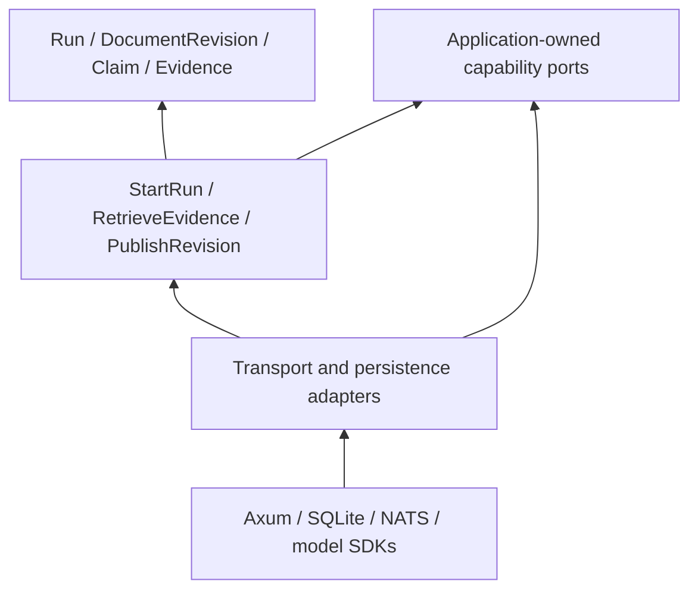

# Robert C. Martin principles review

**Review status: draft design analysis; no application code has been reviewed.** This is an independent application of Robert C. Martin's published architecture principles. Martin did not participate, approve the design, or supply the findings below. The review evaluates boundaries and failure behavior rather than attempting to imitate his voice.

## Review basis

Martin's Clean Architecture separates policy from external mechanisms. Source dependencies point toward the policy layer; frameworks, transport, persistence, and presentation stay outside it. Boundary data should suit the inner application rather than expose a framework's objects. [Robert C. Martin, The Clean Architecture](https://blog.cleancoder.com/uncle-bob/2012/08/13/the-clean-architecture.html)

Applied here, the stable policies include evidence provenance, authorized retrieval, run transitions, cancellation intent, document-revision publication, and entity-resolution decisions. Axum, SvelteKit, SQLite extensions, NATS, model providers, and a DAG engine implement those policies at the edges.

## Proposed dependency structure

Arrows show source dependencies. Runtime calls may travel outward through an application-owned port. Rust traits and ordinary data structures can express this boundary; an additional service or allocation is not required merely to represent a layer.

## Findings and required design changes

### P1 — Define the run protocol before splitting services

The current service inventory does not yet establish who may create, cancel, complete, or replace a generation attempt. If those rules are duplicated in Svelte components, Axum handlers, and workers, reconnect and cancellation can produce contradictory states.

**Remediation:** define a run state machine and application commands first. The application layer owns legal transitions, attempt identity, ownership, and terminal outcomes. HTTP and broker adapters translate requests into those commands. Require duplicate-command, late-event, cancellation, and reconnect scenarios to produce the same valid state regardless of transport.

### P1 — Make evidence policy an application contract

An extracted relationship needs its supporting document revision and source locations. If those constraints exist only in SQL or prompts, a replacement vector extension or extractor can return an answer that the rest of the system cannot verify.

**Remediation:** define `EvidenceRef`, `DocumentRevision`, `ResolvedMention`, and `RelationClaim` contracts independent of database rows. Specify authorization scope, active-revision requirements, uncertainty, and evidence retraction. Retrieval adapters return eligible evidence; source filters and graph expansion must preserve that scope.

### P1 — Give workflow progression one owner

The DAG engine and NATS can both appear to own retries and completion. Independent retry loops risk duplicate expensive extraction and publication of outputs whose inputs have become stale.

**Remediation:** choose one durable owner for workflow state and dependency eligibility. Workers commit idempotent outputs identified by source revision, stage, input dependencies, and processing version. Publication checks the current revision. Events notify consumers about committed results; broker delivery does not define artifact validity.

### P2 — Keep database optimization behind useful capability boundaries

A universal database repository abstraction could hide precisely the vector filtering, BM25 ranking, and graph-expansion behavior that determines retrieval quality. Conversely, leaking virtual-table SQL into run orchestration would couple policy to one extension.

**Remediation:** define focused capabilities such as lexical candidate retrieval, eligible vector candidates, bounded relationship expansion, and revision publication. Specify observable semantics and quality requirements. Keep SQL and extension tuning in adapters. Avoid one interface for every table or a promise that different indexes have identical ranking behavior.

### P2 — Bound modules before adding network boundaries

Separating policy from mechanisms does not establish a need for a microservice per layer. Every remote hop adds serialization, queueing, failure, and cancellation behavior to evaluate.

**Remediation:** keep the live answer path in a cohesive Rust service with internal modules until isolation or measured scale warrants a split. Separate resource-heavy document processing because it needs independent capacity. Justify later boundaries through failure isolation, ownership, or workload evidence.

## Strengths to retain

The draft already separates live chat from enrichment, distinguishes searchable text from graph readiness, and treats graph claims as derived artifacts. Direct browser streaming avoids unnecessary orchestration in the answer path. These choices make failure domains and application policies easier to inspect.

## Acceptance gate

Before the first backend implementation is considered architecturally sound, demonstrate application-level scenarios using in-memory adapters: duplicate start commands, cancellation racing completion, stale document publication, entity-resolution correction, and evidence deletion. Then run adapter contract checks for the selected database and broker. These checks target policy failures; they do not assert that a layering diagram guarantees performance or correctness.
