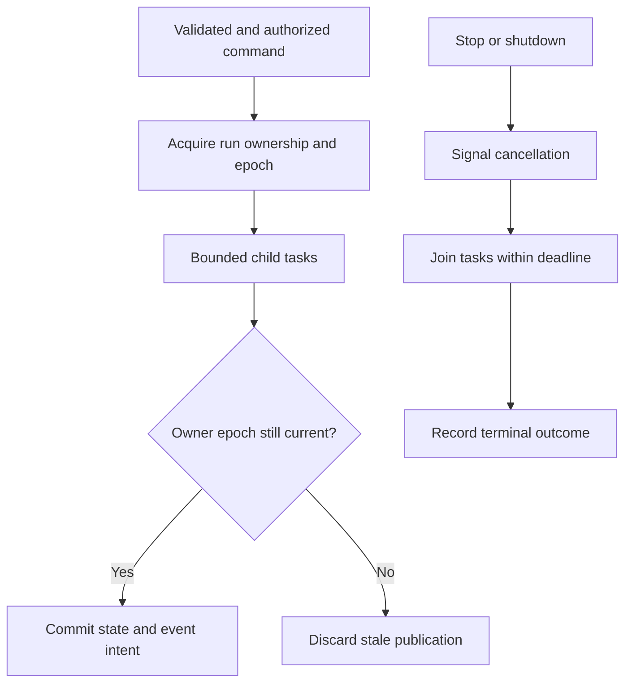

# Rust design review through historical priorities

Status: design review, 2026-11-05. Scope: the proposed backend architecture; no Rust implementation has been inspected. Findings below are requirements to resolve or demonstrate, not claims of observed code defects.

## Attribution and method

Graydon Hoare created Rust's initial design and implementation, as the Rust project's own alumni page records. Rust subsequently evolved through a wider project and community; its current design must not be attributed entirely to one person. Hoare's author-published archive describes the personal project and later Mozilla work. [Rust attribution](https://rust-lang.org/governance/people/graydon/), [Hoare's archive](https://github.com/graydon/rust-prehistory)

This is our analysis through documented priorities, not a simulated review, quotation, or endorsement by Hoare. His 2010 presentation emphasizes safety, concurrency, isolation, controlled mutation, auditable departures from safety, and established techniques. It also describes supervision and task ownership. These are historical positions, not evidence that he endorses Axum, Tokio, a particular database, or today's Rust feature set. [Hoare's primary presentation, slides 3–6 and 13–19](https://venge.net/graydon/talks/intro-talk-2.pdf)

The early presentation supplies the historical lens; modern Rust/Tokio documentation supplies current behavior.

## Assessment

The architecture has useful isolation boundaries: one run owner, narrow adapters, direct streaming, and asynchronous enrichment. It remains a proposal until failure behavior and resource bounds are demonstrated. Rust's ownership/type system prevents important classes of memory and concurrency errors; it does not prove authorization, distributed ownership, claim truth, correct cancellation, or durable publication. Safe Rust can still deadlock, exhaust memory, serve stale evidence, or execute a paid request twice. [Modern Rust concurrency](https://doc.rust-lang.org/book/ch16-00-concurrency.html)

## P1: Make ownership a persistent invariant

An `Arc<Mutex<Run>>` coordinates one process, not replicas after a partition. Specify the authoritative store, atomic claim operation, monotonic fencing epoch, renewal rules, and write-time validation before enabling multiple run owners. Check ownership at event/transcript publication, not only when work starts. Keep terminal transitions conditional and monotonic. Acceptance evidence: delay an old owner past lease expiry, allow takeover, then verify that the old attempt cannot commit or contaminate the current stream.

## P1: Bound blocking work and cancellation leakage

SQLite calls and CPU-heavy parsing must not occupy Tokio execution workers. A blocking pool alone is insufficient if its queue can grow indefinitely. Reserve database/chat permits, bound queued bytes and jobs, and give ingestion a separate budget. Already-started `spawn_blocking` work cannot be aborted through its join handle; shutdown timeouts stop waiting rather than stop that work. Define connection-scoped interruption and late-result disposal. [Tokio blocking behavior](https://docs.rs/tokio/latest/tokio/task/fn.spawn_blocking.html)

Every spawned task needs an owner, join path, and cancellation contract. Do not hold shared locks over network awaits. Review each `select!` branch for cancellation safety around partial reads/writes and side effects. Treat provider cancellation as best effort unless its API establishes stronger semantics. Test disconnect, explicit Stop, provider stalls, and shutdown during each stage. [Tokio select](https://tokio.rs/tokio/tutorial/select), [shutdown](https://tokio.rs/tokio/topics/shutdown)

## P1: Define a finite resource policy

Specify limits for concurrent runs, provider requests, request bodies, prompt/context size, subscriber buffers, retained events, graph depth/fanout, and retry budgets. Queue bounds need byte limits as well as item counts. Define the exact overload and slow-consumer outcome; avoid silently dropping text while signaling completion. Test a stalled reader, huge source document, high-degree entity, and retrying dependency together. Memory safety does not supply an application memory budget.

## P1: Preserve evidence and version consistency

Use immutable source revisions and explicit published projection versions. A late ETL completion must not replace newer chunks or restore deleted evidence. An authorization filter must apply to lexical, vector, graph, and source-fetch paths; a final filter after global vector top-k is not sufficient for correct eligible retrieval. Keep mentions, canonical identity decisions, and source-backed relation claims distinct.

Avoid retaining a database transaction during model generation. SQLite WAL has one active writer and requires same-host access; long readers can hinder checkpoints. If independent read connections must see one retrieval generation, specify the publication/version strategy rather than assuming concurrent queries share a snapshot. Validate revision replacement, ACL changes, entity splits, and deletes while chat and ingestion compete. [SQLite WAL](https://www.sqlite.org/wal.html)

## P1: Close durability gaps explicitly

JetStream can redeliver work. Use deterministic operation identities and idempotent database commits, then acknowledge. Persist outbox intent with the state change and tolerate duplicate publication. Keep broker acknowledgment, database commit, and external model execution as separate failure boundaries; do not label the combined system exactly once. Test crashes before/after each boundary. [JetStream delivery](https://docs.nats.io/learn/jetstream/delivery-and-acknowledgment)

Similarly, distinguish replaying accepted output from restarting inference. Decide whether displayed deltas must survive a crash; asynchronous persistence cannot promise that without an explicit loss window. A reconnect must never invisibly create a second generation attempt.

## P1: Audit the native extension boundary

Safe Rust wrappers do not prove the soundness of SQLite or C vector extensions. Pin and record native versions, review thread/connection ownership, validate vector dimensions and blob sizes, and disable unneeded extension loading. Concentrate any application `unsafe` in a small adapter with documented preconditions. Exercise malformed data and cancellation at the boundary; consider process isolation when a native crash must not take down chat. The Rustonomicon explains why foreign interfaces require caller-verified contracts. [Rust FFI](https://doc.rust-lang.org/nomicon/ffi.html)

## P2: Prefer explicit, measured simplicity

Use typed identifiers, small state enums, and concrete error variants to encode local invariants. Keep ports limited to genuine boundaries. Do not invent a durable scheduler while Dagster/Temporal remains undecided, or distribute a local function merely to use NATS. Choose vector indexes using filtered recall and concurrent latency measurements. Accept the design only after fault-injection and workload evidence; language selection alone establishes neither correctness nor a performance lead.
